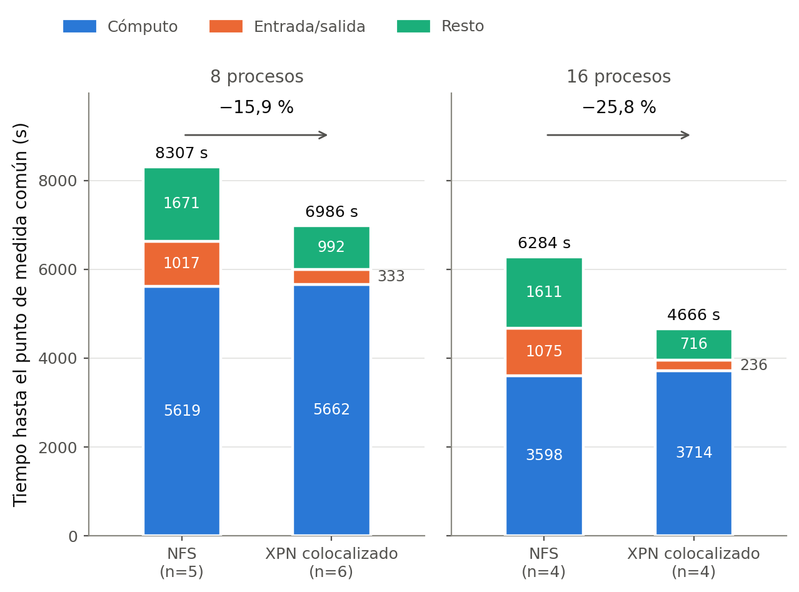
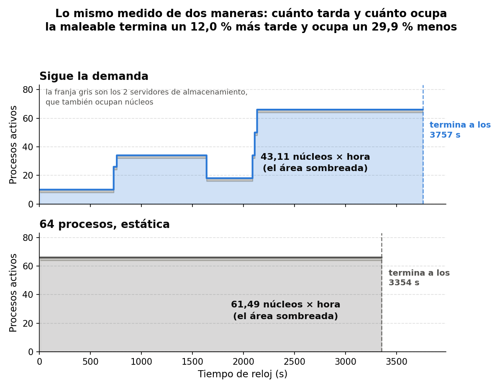

# Gestión dinámica de recursos de cómputo y E/S: EpiGraph + Expand Ad-Hoc + FlexMPI

Código del Trabajo Fin de Grado de **Pablo Navarro Hurtado** (Grado en Ingeniería Informática,
Universidad Carlos III de Madrid, defendido en septiembre de 2026). Tutora: Paula Sánchez Checa.

📄 **Memoria completa:** [`docs/memoria_TFG.pdf`](docs/memoria_TFG.pdf)

> **In English.** Bachelor's thesis code. An MPI epidemic simulator (EpiGraph) is integrated
> with a malleable ad-hoc parallel file system (Expand/XPN) and a malleability library
> (FlexMPI) on a Docker-based virtual cluster, deployed both on a laptop and on UC3M's *Tucán*
> HPC cluster under Slurm. I/O is redirected to the parallel file system via library
> preloading, without modifying or recompiling the application, and both compute processes
> and storage servers are resized while the simulation runs. Key results: writing through the
> parallel file system cuts I/O time by up to **78.1 %** and total runtime by up to
> **25.8 %** (16 processes); the malleable run uses **29.9 % fewer core-hours** than a static
> configuration sized for the peak; storage server *placement* matters more than server
> *count*. Contributions include seven fixes to FlexMPI's monitor and load balancer, patches
> to EpiGraph and XPN, a multi-node container deployment, resumable measurement campaigns and
> the analysis pipeline.

**Stack:** C · MPI (MPICH, FlexMPI) · Expand/XPN · Docker / Docker Swarm · Slurm · PAPI ·
Bash · Python (matplotlib)

## Resultados principales

| | |
|---|---|
|  |  |
| **CE1.** Redirigir la E/S a XPN reduce la entrada/salida un 67,3 % (8 procesos) y un 78,1 % (16), y el tiempo total un 15,9 % y un 25,8 %. | **CE3.** La ejecución maleable sigue la demanda de la epidemia: termina un 12,0 % más tarde que la estática de 64 procesos, pero ocupa un 29,9 % menos de núcleos × hora. |

---

## Sobre este repositorio

Integración de **EpiGraph** (simulador epidémico paralelo), **FlexMPI** (maleabilidad y
balanceo de carga) y **Expand/XPN** (sistema de ficheros paralelo) sobre un despliegue en
contenedores, y campañas de medida sobre el clúster Tucán.

Pablo Navarro Hurtado · 100495879@alumnos.uc3m.es · septiembre de 2026

Esto es una **recopilación**, no el árbol de trabajo completo: se ha extraído lo que se ha
escrito o modificado durante el trabajo y se han dejado fuera los registros de las
ejecuciones, los datos de población, los binarios y los diagnósticos intermedios. La ruta
original de cada fichero está indicada en su apartado.

## Punto de partida

Tres códigos que ya existían y que **no son míos**:

| Componente | Origen |
|---|---|
| EpiGraph | Grupo ARCOS (UC3M). No es software libre; se trabajó sobre la copia facilitada |
| FlexMPI | Grupo ARCOS (UC3M), `FlexMPIDeveloper` |
| Expand/XPN | <https://github.com/xpn-arcos/xpn> |
| `xpn-docker` | <https://github.com/xpn-arcos/xpn-docker>, base del despliegue en contenedores |

Sobre los tres primeros el trabajo consistió en **modificaciones puntuales** al código
fuente, que se entregan aquí como parches para poder leer qué cambia y por qué. Sobre el
cuarto, en ampliar el despliegue a varios nodos físicos. Todo lo demás ---lanzadores,
orquestadores de campaña, utilidades de operación y análisis--- se ha escrito de cero.

## Organización

```
1_modificaciones_codigo/   parches a FlexMPI, EpiGraph y Expand/XPN
2_despliegue/              contenedores: despliegue multinodo y preparación del entorno
3_lanzadores/              una ejecución de EpiGraph con una configuración dada
4_campanas/                lotes reanudables que barren varias configuraciones
5_operacion/               vigilancia de la reserva y muestreo de CPU/E-S
6_analisis/                medida a iteración común y figuras de la memoria
```

---

# 1. Modificaciones al código fuente

## 1.1 FlexMPI

`1_modificaciones_codigo/flexmpi/flexmpi_TFG.patch` — diferencias de `src/monitor.c`,
`src/lbalance.c`, `src/server.c` e `include/defs.h` respecto al último commit del
repositorio. Está generado ignorando espacios en blanco, para leerlo; no está pensado para
aplicarse con `patch`. La lista razonada de los cambios está en `CAMBIOS_FLEXMPI.md`, que es
el documento que se fue manteniendo durante el trabajo.

Los siete cambios, y el problema que resuelve cada uno:

1. **`monitor.c` ~438 — evento de PAPI.** El contador leído era `PAPI_TOT_INS`, que devuelve
   `PAPI_ENOEVNT` dentro del contenedor: las métricas de FLOPs salían a cero y sin ellas el
   balanceador no tiene entrada. Se vuelve a `PAPI_FP_OPS`.
2. **`monitor.c` ~4207 — el balanceo no se ejecutaba nunca con maleabilidad activa.** En la
   política `MALLEABILITY_TRIG`, la llamada a `EMPI_LBalance` estaba comentada en la rama
   que se toma cuando el controlador no manda ninguna orden de añadir o quitar procesos, o
   sea en la inmensa mayoría de las evaluaciones. Descomentarla es lo que hace que exista
   el caso de estudio CE4.
3. **`monitor.c` ~4690 — reparto tras un `spawn` con FLOPs a cero.** El reparto de filas
   pondera por `flops/rtime`. Si los procesos que ya existían miden cero, se les asigna cero
   filas y todo el trabajo va a los recién creados, que se quedan solos mientras el resto
   espera en la barrera. Se añade un reparto equitativo como alternativa cuando eso ocurre.
4. **`lbalance.c` ~1177 — salida temprana con FLOPs a cero.** `EMPI_LBalance` abandonaba si
   cualquier proceso reportaba cero operaciones en coma flotante, cosa que en este entorno
   ocurre de forma legítima. Se desactiva la comprobación.
5. **`lbalance.c` ~1185 — el desequilibrio de CPU no llegaba a evaluarse.** La función salía
   en cuanto el tiempo real parecía equilibrado, y en una aplicación con barreras el tiempo
   real *siempre* lo parece: los procesos rápidos esperan al lento. Ahora se exige que
   también lo esté el tiempo de CPU.
6. **`lbalance.c` ~1201 — el rebalanceo por CPU exigía máquina dedicada.** Los procesos
   bloqueados en barreras tienen tiempo de CPU muy por debajo del tiempo real, y con ese
   perfil FlexMPI los clasifica como no dedicados, de modo que nunca rebalanceaba. Se
   suprime esa condición.
7. **`defs.h` — `NUMBER_OPTIONS` de 100 a 256.** Es el tope de opciones que admite el
   analizador de órdenes del controlador. Con expansiones grandes se rebasa y la orden se
   trunca sin aviso.

El parche recoge además dos cambios que no están en esa lista: la rama de la política de
recuento (`-lbpolicy-counts`, la que usan todas las campañas) en los tres caminos de
reducción de procesos, y unas órdenes de prueba con destino fijo en `server.c` que quedan
desactivadas con una guarda `if (0 && …)` para que no interfieran.

## 1.2 EpiGraph

`1_modificaciones_codigo/epigraph/epigraph_TFG.patch` — diferencias de
`src/epidemiology/epidemiology_sync.c` y `src/epigraph_mpi.c` respecto a la copia de
febrero de 2026, que es el estado en que se recibió el código.

1. **Día de *checkpoint* y de restauración parametrizados.** Estaban fijos en el código
   (`CHECKPOINTDAY = 55`) y ahora se leen de `EPIGRAPH_CHECKPOINTDAY` y
   `EPIGRAPH_RESTOREDAY`. Es lo que permite que la maleabilidad por parada y reanudación
   cambie de fase en el día que pida el experimento, sin recompilar.
2. **Cadencia del volcado de estado ligada a `EMPI_GLOBAL_niter_lb`.** El volcado estaba
   fijado a una vez por día simulado (1440 iteraciones). Ligarlo al parámetro `-nilb` es lo
   que permite subir la frecuencia de escritura a diez volcados por día y hacer visible el
   efecto del sistema de ficheros.
3. **`EMPI_Monitor_init()` a esa misma cadencia.** Se llamaba una vez por día simulado
   mientras que `EMPI_Monitor_end()` se llama en cada evaluación del balanceador: los
   contadores de PAPI no se reiniciaban al mismo ritmo al que se leían y las métricas
   acumulaban basura. Es la causa de que ese mismo parámetro `-nilb` gobierne dos cosas a
   la vez, cosa que la memoria discute en CE4.
4. **`epigraph_mpi.c` — prefijo de rutas `@` para la creación de procesos.** `MPI_Comm_spawn`
   serializa los argumentos por PMI-1, que no admite un argumento vacío y aborta con
   *unable to parse PMI command*. El lanzador pasa `@` como prefijo de rutas y el programa
   lo traduce a la cadena vacía en una variable local, **sin tocar `argv`**, porque FlexMPI
   reutiliza ese mismo `argv` para crear los hijos. Sin este cambio no funciona ninguna de
   las campañas de maleabilidad por creación nativa de procesos.

## 1.3 Expand/XPN

`1_modificaciones_codigo/xpn/01-xpn-client-reload.patch` — reconfiguración en caliente de la
tabla de servidores. Expand lee `config.txt` una sola vez, en la inicialización del cliente,
así que un cliente ya arrancado no puede enterarse de que el almacenamiento ha cambiado de
tamaño: es el bloqueo que impedía reducir el número de servidores sin parar la aplicación.
El parche añade `xpn_reload_partition()` y engancha `xpn_reload_if_needed()` en
`xpn_open.c`, que es el punto único por el que pasan `open` y `creat` y el único momento en
que el proceso no tiene ninguna operación en vuelo. Sólo actúa si está definida la variable
`XPN_RECONF_FILE`, de modo que sin ella el comportamiento es el de siempre.

**Además, el `bypass` de XPN necesita un retoque en la compilación**: `xpn_bypass.c` define
su propio `MPI_Init`, que choca con el de la biblioteca de FlexMPI y deja la interceptación
de la E/S sin efecto ---la aplicación escribía en NFS creyendo que escribía en Expand---. Se
resuelve renombrando ese símbolo antes de compilar la biblioteca:

```bash
sed 's/int MPI_Init (/int MPI_Init_DISABLED (/' xpn_bypass.c   # y make
```

El objeto resultante se guarda como `/shared/xpn_bypass_patched.so` y es el que precargan
todos los lanzadores. Esto está en el encabezado de `3_lanzadores/lanza_xpn.sh`.

---

# 2. Despliegue

Ruta original: `xpn-docker/`.

- **`xpn_docker_TFG.patch`** — ampliación de `xpn_docker.sh`, el guion de despliegue de
  `xpn-docker`, que sólo contemplaba un nodo físico o un servicio único repartido por Swarm.
  Se añaden dos modos: uno con **dos servicios** (EpiGraph en un nodo, los servidores de
  Expand en otro) y otro **distribuido**, con los dos servicios repartidos entre los dos
  nodos. Lo que resuelve el segundo es un detalle que cambia el resultado del experimento:
  al construir el fichero de máquinas, los servidores de Expand se **intercalan** por nodo
  físico, porque si se listan agrupados un barrido que tome dos servidores los toma del
  mismo nodo y deja a la mitad de los clientes sin servidor local, que es justo lo que se
  quería medir. Incluye también la espera a que todas las réplicas estén en marcha antes de
  leer sus direcciones.
- **`dockerstack_multinodo.yml`**, **`dockerstack_multinodo_dist.yml`** — las dos pilas de
  Swarm correspondientes.
- **`ce4_pop.sh`** — conmuta entre las dos poblaciones simuladas (Madrid, 3 511 110
  individuos, y la reducida de 800 826). El binario abre `./cities/` por una ruta fija y lee
  el tamaño de población de un XML: los dos tienen que ir a juego o la ejecución aborta, así
  que el guion cambia los dos a la vez y sabe volver atrás.
- **`ce4_deps.sh`** — instala en todos los contenedores del despliegue las bibliotecas que
  la imagen no trae (GLPK, GSL y PAPI). Sin ellas EpiGraph termina nada más arrancar.

---

# 3. Lanzadores

Ruta original: `xpn-docker/install-src/`. Cada uno ejecuta **una** simulación completa con
una configuración dada, desde dentro del contenedor principal: levanta los servidores de
Expand, arranca el controlador de FlexMPI, compone el fichero de máquinas, lanza `mpiexec` y
recoge el registro. Se configuran por variables de entorno. `lanza_xpn_estatico.sh` escribe además en la
primera línea del registro la configuración con la que se midió ---cadencia, política de
balanceo y población---, para no tener que adivinarla después.

| Fichero | Qué ejecuta | Dónde se usa |
|---|---|---|
| `lanza_xpn_estatico.sh` | EpiGraph + FlexMPI + Expand, número de procesos fijo. Admite despliegue *colocalizado* (todos los nodos hacen de cliente y de servidor) o *exclusivo* (los últimos nodos sólo sirven almacenamiento) | CE1, CE2, CE4 |
| `lanza_xpn_sin_expand.sh` | La misma ejecución sobre NFS, sin Expand | Referencia de CE1 |
| `lanza_xpn_sin_flexmpi.sh` | Con Expand pero con el balanceo desactivado | Referencia de CE4 |
| `lanza_xpn.sh` | Maleabilidad por **parada y reanudación**: la simulación guarda su estado en un día dado, termina, y se relanza con otro número de procesos | CE3 |
| `lanza_xpn_dmr.sh` | Maleabilidad por **creación nativa de procesos** (`MPI_Comm_spawn`), sin reiniciar `mpiexec` | CE3 |
| `lanza_multinodo_waypoints.sh` | Maleabilidad multinodo por **calendario**: `WAYPOINTS="día:procesos …"`. Las ampliaciones se piden **en lotes**, releyendo después de cada uno el número real de procesos, porque una petición grande de una vez se completa a medias; las reducciones se dirigen al recuento real, no al pedido | CE3 |
| `lanza_comaleabilidad.sh` | Lo anterior más un calendario propio para Expand (`XPN_WAYPOINTS="día:servidores"`): los dos recursos, procesos y servidores de almacenamiento, se reconfiguran en la misma ejecución | CE3, co-maleabilidad |

---

# 4. Campañas

Ruta original: `xpn-docker/install-src/` y `xpn-docker/`.

Un lote recorre varias configuraciones sobre un mismo despliegue. Son **reanudables**: al
arrancar saltan las celdas que ya tienen su registro completo, de modo que un corte no
obliga a repetir lo ya medido. Cada uno archiva sus registros en su propio subdirectorio y
va escribiendo un resumen.

- **`lanza_lote_ce3.sh`** — cierra los pendientes de CE3 en dos fases, porque son dos
  despliegues distintos.
- **`lanza_lote_ce4b.sh`** — deja CE4 sin ninguna celda medida una sola vez. Su encabezado
  explica por qué repite celdas que ya tenían dos medidas: estaban tomadas en otro
  despliegue, y el ruido entre despliegues (un 1 %) es del mismo orden que la diferencia que
  se quiere afirmar, así que las cuatro celdas de un mismo eje tienen que medirse juntas.
- **`arranca_lote_ce4b.sh`** — orquestador de los dos lotes de un solo nodo, con el
  redespliegue entre ambos.

Los encabezados de estos tres ficheros documentan celda a celda qué se mide y por qué; son
la mejor entrada al diseño de las campañas.

---

# 5. Operación

Ruta original: `xpn-docker/`.

- **`guardian_antidrain.sh`** — vive en el nodo de acceso y vigila el tiempo que le queda a
  la reserva de Slurm. Cuando baja de un margen dado, para los contenedores **antes** de que
  Slurm mate el trabajo. Sin esto, el nodo queda en estado `drain` y hace falta que lo
  rescate el administrador. Va desacoplado de la sesión, así que sobrevive a que se caiga la
  conexión o la VPN.
- **`sample_cpu_host.sh`** — corre en el anfitrión, en paralelo al experimento: muestrea
  `docker stats` cada tres segundos, lee de qué fase de la simulación se trata y escribe dos
  tablas, de CPU y de E/S. Es el origen de las figuras de ocupación de CPU de la memoria.

---

# 6. Análisis

Ruta original: `xpn-docker/install-src/EpiGraphFlexMPI-XPN/` y su subdirectorio
`logs_ya_mirados/tucan/`.

- **`extrae_iter.sh`** — extrae de un registro el tiempo y la E/S acumulada **a una
  iteración común** (la 185 760, ya avanzada la segunda ola). Es la pieza central de todas
  las medidas, porque las comparaciones se hacen en el mismo instante de la simulación y no
  sobre la duración total. Contempla los **dos formatos** en que aparece la línea
  de E/S ---uno de ellos sin marca de tiempo, cuando se entremezcla la salida de varios
  procesos---; un lector ingenuo se deja el segundo y subestima la E/S hasta en un 8 %.
- **`mide_ce3.py`**, **`mide_ce3_dia_destino.py`** — recorren un directorio de registros y
  producen las tablas de CE3, integrando el consumo de recursos a partir del número de
  procesos **realmente** declarado en cada instante, que no coincide con el que pidió el
  calendario.
- **`graficar_*.py`** — generan las figuras de la memoria: `variabilidad` (dispersión entre
  ejecuciones y entre despliegues), `ce1`, `ce2`, `ce3_consumo` (procesos reservados frente
  a tiempo, de modo que el área bajo la curva es el consumo), `ce3_frontera`,
  `ce3_momento_magnitud` y `ce4`.

---

# Cómo se ejecuta un experimento

Resumen del ciclo completo; el detalle está en el capítulo 5 de la memoria.

```bash
# En el anfitrión, sobre un nodo reservado
./xpn_docker.sh build          # sólo la primera vez
./xpn_docker.sh start 8        # ocho contenedores
docker exec xpn_docker-node-1 bash /shared/install-src/ce4_deps.sh

# Una ejecución estática de ocho procesos
docker exec xpn_docker-node-1 bash /shared/install-src/lanza_xpn_estatico.sh 8

# Una campaña entera, desacoplada de la terminal
docker exec -d xpn_docker-node-1 bash /shared/install-src/lanza_lote_ce4b.sh
```

Dentro del contenedor, `/shared/` es el directorio `xpn-docker/` del anfitrión. Los
registros quedan en `install-src/EpiGraphFlexMPI-XPN/mis_logs/`.

Para recompilar tras tocar el código fuente, dentro del contenedor:

```bash
cd /shared/install-src/FlexMPIDeveloper      && make cleanlib && make
cd /shared/install-src/EpiGraphFlexMPI-XPN   && make clean    && make
```

Los dos tienen que compilarse contra los encabezados de PAPI instalados en
`/shared/papi-install/`, no contra los del sistema, o los contadores vuelven a salir a cero.

---

# Correspondencia con la memoria

| Capítulo o sección | Qué código lo sostiene |
|---|---|
| §5.1 Plataforma de ejecución | `2_despliegue/` |
| §5.2 Integración y puesta en marcha | `1_modificaciones_codigo/` |
| §6.2 Variabilidad de las medidas | `6_analisis/extrae_iter.sh`, `graficar_variabilidad.py` |
| §6.3.1 CE1 — interceptación de la E/S | `lanza_xpn_estatico.sh`, `lanza_xpn_sin_expand.sh` |
| §6.3.2 CE2 — despliegue del almacenamiento | `lanza_xpn_estatico.sh` (modo exclusivo), `2_despliegue/` |
| §6.3.3 CE3 — maleabilidad de procesos | `lanza_xpn.sh`, `lanza_xpn_dmr.sh`, `lanza_multinodo_waypoints.sh`, `lanza_comaleabilidad.sh`, `4_campanas/lanza_lote_ce3.sh` |
| §6.3.4 CE4 — rebalanceo de carga | `lanza_xpn_sin_flexmpi.sh`, `4_campanas/lanza_lote_ce4b.sh`, cambios 2, 4, 5 y 6 de FlexMPI |
